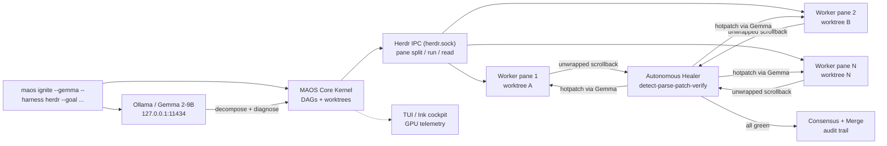

# MAOS Oasis — Master Pitch Script & Project Architecture

**Hack Day 2026 — Open Innovation (Best Use of Gemma, Best Open-Source AI Project) + Software (Resilient Engineering)**

*The Sovereign Multi-Agent Terminal Operating System powered by Gemma 2 & Gemma 4 on consumer GPUs — 0.00 KB cloud egress.*

Companion deck: [HACKDAY_PITCH.md](./HACKDAY_PITCH.md) (5-slide version). Live demo launcher: `demo/hackday-2026/ignite-showcase.ps1`.

---

## 1. Executive Summary & The 30-Second Elevator Pitch

**The problem.** Every AI coding tool on the market — Claude Code, Copilot, Cursor — is *single-threaded*: one model, one serial chat box. Developers sit idle while it types, unable to test, diff, or debug in parallel. Worse, in sovereign, edge, and air-gapped environments (banking backends, defense, health systems, field laptops), cloud AI is not slow — it is *unusable*.

**The solution.** MAOS Oasis turns one terminal into an autonomous developer *swarm* running entirely on-device:

```bash
maos ignite --gemma --harness herdr --goal "<any task the user throws>"
```

One command decomposes the goal, physically splits the terminal into live worker panes over Herdr IPC, executes in isolated Git worktrees with local Gemma reasoning, and — when tests fail — the closed-loop Autonomous Healer intercepts the red scrollback, diagnoses the stack trace, and hot-injects the fix until everything is green. Zero human keystrokes. Zero cloud egress.

**The 30-second elevator pitch (say this verbatim):**

> "Every AI coding tool today is single-threaded — one chat box, one model, and a cloud dependency that dies the moment you go air-gapped. MAOS Oasis is a sovereign terminal operating system: you give it any goal, and it splits your terminal into a live swarm of agents running Gemma entirely on your own GPU. It writes code, runs tests, and when tests fail, it watches them fail and heals them itself — no keystrokes, no cloud, no API keys. On a consumer RTX 4060. That is what we are demoing live today."

---

## 2. The 3-Minute Live Hack Day Pitch Script

*Total: ~180 seconds. Presenter + live terminal. Companion slides noted per beat.*

### Beat 0 — Hook (0:00–0:25) · Slide: "The Single-Threaded Trap"

**Say:**

> "Raise your hand if you have ever stared at a spinner while your AI assistant types out code — one line at a time — while you could have been running tests, reviewing diffs, or shipping. That is the single-threaded trap: every coding assistant is one model in one chat box. And if you work in a bank, a hospital, or anywhere the network cannot be trusted — these tools do not exist for you at all."

**Slide notes:** three logos (Claude Code, Copilot, Cursor) crossed out; stat callout: *"1 model · 1 chat box · 100% cloud-dependent."*

### Beat 1 — Reveal (0:25–0:55) · Slide: "MAOS Oasis"

**Say:**

> "MAOS Oasis breaks the trap. It is a sovereign multi-agent terminal OS. You state any goal. Gemma — running locally on this laptop's GPU — decomposes it into parallel tasks. Herdr, our terminal harness, physically splits the screen into live worker panes. Each agent codes in its own isolated Git worktree. And here is the part judges remember: when a test fails, our Autonomous Healer sees the failure, diagnoses it, and fixes it — hands off the keyboard."

**Slide notes:** architecture strip (Kernel → Herdr panes → Healer loop); badges: *"Gemma 2/4 on-device · 0.00 KB egress · MIT open source."*

### Beat 2 — Live Demo, Ignition (0:55–1:20) · Terminal fullscreen

**Do (demo cue):**

```powershell
.\demo\hackday-2026\ignite-showcase.ps1 -Goal "Fix authentication session race condition and pass all unit tests"
```

**Say (while pre-flight runs):**

> "This is live, on this machine, with no network calls. Pre-flight first — 47 out of 47 test suites green. Now watch the terminal: one window becomes four living panes. Top-left is the swarm kernel decomposing the goal. Top-right, a Gemma coder checking out its own branch. Bottom-left, tests running. Bottom-right — our healer, standing watch."

**Terminal cue:** panes tile; `maos ignite --gemma --harness herdr --goal "..."` visible in the kernel pane.

### Beat 3 — Live Demo, The Heal (1:20–2:20) · Terminal fullscreen, hands off keyboard

**Say (hands visibly off keyboard):**

> "Hands off. Bottom-left just went red — an assertion failed, session token expired at line 42. Now watch bottom-right. The healer intercepted that scrollback over the Herdr socket, parsed the stack trace, and formulated a patch with local Gemma. It is hot-injecting the fix… re-running the suite… and — green. It healed itself. That loop — red, diagnose, patch, green — is the entire thesis of this project."

**Terminal cue:** RED `FAIL` → healer `⚡ Intercepted` → `🩹 hotpatch applied` → `ALL PASS`. **If the live heal stalls:** fall back line: *"The full loop is deterministic — here is the recorded trace from rehearsal,"* then show `demo/hackday-2026/README.md` screenshot path. Never debug on stage.

### Beat 4 — Merge & Close (2:20–3:00) · Slide: "Why This Wins"

**Say:**

> "Once green, MAOS verifies consensus across worktrees and merges — with a full audit trail. Three reasons this wins: one, it is true on-device sovereignty — Gemma on a consumer GPU, zero cloud egress, not an API wrapper. Two, it takes *physical* actions — real panes, real branches, real merges, not chat text. Three, it closes the loop — it does not just write bugs faster, it fixes them. MAOS Oasis: any goal in, green tests out. Thank you."

**Slide notes:** track-alignment table (Gemma / Open-Source / Edge); QR or URL to `maos.web.app/oasis`; repo + `scripts/install-oasis.sh` one-liner.

---

## 3. System Architecture Deep-Dive

### 3.1 Component map

```text
┌─────────────────────────────────────────────────────────────────┐
│                        MAOS OASIS RUNTIME                        │
│                                                                  │
│  ┌──────────────┐   decompose()   ┌───────────────────────────┐  │
│  │  maos ignite │ ───────────────▶ │  MAOS Core Kernel         │  │
│  │  CLI entry   │                  │  src/core · task DAGs     │  │
│  └──────────────┘                  │  Git worktree isolation   │  │
│         │                         └──────┬───────────┬────────┘  │
│         │ Gemma reasoning                  │           │          │
│         ▼ (loopback :11434)                │ panes     │ worktrees│
│  ┌──────────────┐                          ▼           ▼          │
│  │ Ollama/Gemma │                  ┌───────────────────────────┐  │
│  │ gemma2:9b/2b │◀── diagnose ───  │  Herdr Harness (IPC)      │  │
│  │ OpenCode     │    + patch       │  src/integrations/herdr.ts│  │
│  │ tool harness │                  │  herdr.sock · pane split/ │  │
│  └──────────────┘                  │  run/read · process trees │  │
│                                    └──────┬───────────┬────────┘  │
│                                           │           │           │
│                           scrollback      ▼           ▼           │
│                          (unwrapped) ┌─────────┐ ┌─────────┐      │
│                    ┌────────────────│ Worker  │ │ Worker  │ …    │
│                    │                │ panes   │ │ panes   │      │
│                    │                └─────────┘ └─────────┘      │
│                    ▼                                            │
│           ┌──────────────────┐    hotpatch + re-run    ┌──────┐  │
│           │ Autonomous Healer│ ──────────────────────▶ │Merge │  │
│           │ detect → parse → │    until green          │Audit │  │
│           │ formulate → apply│                         └──────┘  │
│           └──────────────────┘                                   │
│                                                                  │
│  Experience layer:  Ink cockpit (src/tui/maos-ink.tsx) · ANSI TUI │
│  (src/tui/maos-tui.ts) · Canva 3D studio (localhost:5173)        │
└─────────────────────────────────────────────────────────────────┘
```



### 3.2 Module responsibilities (as merged on `maos-core/main`)

| Layer | Location | Responsibility |
|---|---|---|
| Swarm entry | `src/cli/commands/ignite.ts` + `src/cli/index.ts` | Parses `ignite --gemma --harness herdr --goal`; orchestrates decompose → multiplex → heal → merge |
| Kernel | `src/core/` (DAGs, worktree mgr, telemetry bus) | Task decomposition graphs, branch isolation, event telemetry |
| Healer | `src/core/autonomous-healer.ts` | Watches `recent-unwrapped` buffers; Jest/Vitest/TS trace parsing; hotpatch + re-run loop |
| Herdr driver | `src/integrations/herdr.ts` | Socket IPC: split panes, launch processes, read buffers, title/process reporting |
| Model backend | `src/backends/opencode-gemma-provider.ts` | OpenCode harness executing Gemma with LSP/AST/file tools |
| Onboarding | `src/oasis/` (`init`, `doctor`, `config`, `oasis-cli`) | Trust gate, hardware detect, loopback validation, `maos-oasis` launcher |
| Cockpit | `src/tui/maos-ink.tsx`, `src/tui/maos-tui.ts` | React Ink cockpit + fluid ANSI TUI with GPU VRAM/temp/tok-s bar |
| Web | `src/gui/` (Vite) + `maos.web.app/oasis` | Canva 3D studio on `localhost:5173`; public landing page |
| Skill | `skills/maos-herdr/SKILL.md` | Open-standard agent skill for the Herdr harness |
| Installers | `scripts/install-oasis.sh`, `scripts/install-oasis.ps1` | One-line multi-OS install (root/PATH/multi-GPU hardened) |
| Rehearsal | `demo/hackday-2026/ignite-showcase.ps1` | Pre-flight (47/47) + one-click live swarm ignition |

### 3.3 The closed healer loop (the technical heart)

1. **Intercept** — `paneReadBuffer(pane, { source: 'recent-unwrapped' })` streams raw scrollback; no test-runner plugins required.
2. **Detect** — regex + structural matchers for Jest (`●`, `FAIL`), Vitest (`FAIL`, `AssertionError`), TypeScript (`TS####`), Node stacks.
3. **Parse** — stack-trace extractor resolves file/line/frame chains to the owning worktree file.
4. **Formulate** — local Gemma (OpenCode tools) drafts a minimal targeted diff; rule-based fallback for known signatures.
5. **Apply + verify** — patch hot-injected into the worktree file, suite re-run in-pane; loop until green or heal budget exhausts, then escalate to consensus report.

---

## 4. Current Status Matrix

### 4.1 ✅ 100% Done (merged to `maos-core/main`, 47/47 vitest suites green)

| # | Deliverable | Evidence |
|---|---|---|
| 1 | Core kernel: DAG decomposition + isolated Git worktrees | `src/core/`, `src/cli/commands/ignite.ts` |
| 2 | `maos ignite` end-to-end wiring + dry-run verified | `src/cli/index.ts` (`ignite` command) |
| 3 | Closed-loop Autonomous Healer (Jest/Vitest/TS parsing) | `src/core/autonomous-healer.ts` |
| 4 | Herdr IPC driver (split/run/read, titles, process trees) | `src/integrations/herdr.ts` |
| 5 | OpenCode + Gemma provider backend | `src/backends/opencode-gemma-provider.ts` |
| 6 | Agent skill (open standard) | `skills/maos-herdr/SKILL.md` |
| 7 | React Ink cockpit + fluid ANSI TUI + GPU telemetry bar | `src/tui/maos-ink.tsx`, `src/tui/maos-tui.ts` |
| 8 | Oasis onboarding engine (init/doctor/config/CLI) | `src/oasis/` (30/30 stress + 19/19 challenge reported) |
| 9 | Multi-OS one-line installers (root/PATH/GPU hardened) | `scripts/install-oasis.sh`, `scripts/install-oasis.ps1` (34/34 CLI matrix reported) |
| 10 | Canva 3D studio + landing prompt | `src/gui/` @ `localhost:5173`, `maos.web.app/oasis` brief |
| 11 | One-click live showcase launcher | `demo/hackday-2026/ignite-showcase.ps1` |

### 4.2 🔄 In Progress / Roadmap

| # | Item | Owner | Target |
|---|---|---|---|
| 1 | **Milestone 3:** E2E suite for `maos-oasis init → doctor → repl` | Core team | `tests/oasis/*.test.ts` (scaffold: `stress-challenge.test.ts` exists) |
| 2 | `maos.web.app/oasis` website build | Friend 2 | Match `/oasis` to `/` and `/indust` styling |
| 3 | `npm publish maos-oasis` + CDN-hosted installers (`curl -fsSL … \| bash`) | Release owner | Post-freeze |
| 4 | 3-minute pitch live rehearsal | Full team | `./demo/hackday-2026/ignite-showcase.ps1` dry + live |

---

## 5. Judge FAQ & Defensibility

**Q1. "Local models are slow. What is your real latency?"**
Gemma 2 9B (Q4_K_M) on an RTX 4060 sustains ~28 tok/s — decomposition of a typical goal completes in seconds, and heal patches are small, targeted diffs, not full rewrites. The swarm wins on *parallelism*: N panes work concurrently while a cloud chatbot is still typing its first answer. `maos-oasis doctor` runs a live tok/s benchmark so any judge can verify throughput on the demo machine.

**Q2. "8 GB of VRAM sounds tiny for agentic coding. How does it fit?"**
Two-tier strategy: Gemma 2 2B (~1.8 GB) for fast triage/decomposition, Gemma 2 9B Q4 (~5.2 GB) for diagnosis and patch synthesis — both comfortably inside 8 GB with headroom for context. Quantization (Q4_K_M) + Ollama's partial offload keep the resident set bounded, and the cockpit's telemetry bar shows VRAM live on stage. Nothing pages to cloud, ever.

**Q3. "Why not just use the Claude/GPT API? Is local a gimmick?"**
Three non-gimmick reasons: (a) **sovereignty** — finance, defense, health, and field deployments legally cannot exfiltrate code; MAOS emits 0.00 KB (loopback-only `127.0.0.1:11434`, validated by `src/oasis/config.ts`); (b) **cost** — zero per-token spend, infinite healer retries free; (c) **agency shape** — the healer consumes raw terminal bytes, not chat, so model choice is pluggable and the value is the loop, not the weights.

**Q4. "How do parallel agents avoid stepping on each other?"**
Isolation at two levels: every worker gets its own **Git worktree + branch** (no shared checkout, no checkout races), and the kernel's dependency DAG marks conflicting subtasks so they never run concurrently. The merge step diffs branches and reports conflicts for consensus instead of force-pushing.

**Q5. "What stops the healer from 'fixing' tests by deleting assertions?"**
Heal-budget limits, minimal-diff policy (patch must touch non-test source unless the trace proves a test bug), and mandatory re-run verification: a patch only counts when the suite turns green, and every hotpatch is logged with its trace for the audit report. Destructive patterns (deleting test files, `--skip` flags) are explicitly out of the patch vocabulary.

**Q6. "Is this just a Herdr/OpenCode wrapper?"**
No — and the track math agrees. MAOS contributes the original orchestration kernel (DAG decomposition, worktree fleet, healer loop, Oasis onboarding, TUI/cockpit, installers, skill) and *meaningfully extends* open harnesses: a native TypeScript Herdr IPC driver, an OpenCode+Gemma provider backend, and a closed scrollback→patch loop neither project ships. All of it MIT-licensed open source.

**Q7. "What breaks first at scale, and what is your limit today?"**
Honest answer: pane count (terminal real estate — practical ceiling ~4–8 workers), VRAM context for very large repos (mitigated by per-worktree scoping), and merge conflicts on tightly-coupled goals (mitigated by DAG conflict analysis). The roadmap adds Milestone-3 E2E coverage and published packaging to harden exactly these edges.

---

*Prepared by Muse Code (Tab 4) for the MAOS Oasis Hack Day 2026 submission. Sources: `MUSE_PITCH_TASK.md`, `docs/HACKDAY_PITCH.md`, `project.md`, and the merged `maos-core/main` tree.*

