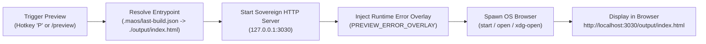

# MAOS Oasis — TUI & Live Preview Operator Guide

**Autonomous Sovereign Multi-Agent Workplace**  
*Gemma-First · 100% Local Loopback · Zero Cloud Transmission*

---

## 1. Overview

The MAOS Oasis **Sovereign Swarm Mission Control TUI** is a high-density, multi-tab terminal user interface built for autonomous software development swarms. It allows developers to prompt, supervise, monitor, and instantly test applications generated entirely on-device by local Gemma models.

The integrated **Live Preview Server** hosts generated web artifacts directly from isolated output directories with zero external cloud dependencies.

```
┌────────────────────────────────────────────────────────────────────────┐
│                              MAOS OASIS                                │
│                Sovereign Multi-Agent Swarm Mission Control             │
├──────────────┬─────────────────────────────────────────────────────────┤
│ ⌂ Dashboard  │                                                         │
│ ◈ Chat       │  [Tab 1: Swarm Execution & Build Diff Transcript]       │
│ ❖ Swarm      │  ✔ Decomposition: 1 focused agent (Atomic Task)        │
│ ▥ Telemetry  │  ✔ Worktree: maos-ignite/build-snake-1                  │
│ ☰ Event Log  │  ✔ Built artifacts: ./output/index.html                 │
│ ───────────  │                                                         │
│ ⚙ Settings   │  🚀 Live Preview: http://localhost:3030/output/index.html│
├──────────────┴─────────────────────────────────────────────────────────┤
│ ❯ /preview                                                             │
└────────────────────────────────────────────────────────────────────────┘
```

---

## 2. Launching the TUI

Depending on your working context, launch the TUI using any of the following commands:

### Direct Command via Oasis CLI:
```powershell
node "C:\HACKDAY WINNER\maos-core\dist\oasis\oasis-cli.js" tui
```

### From within `maos-core`:
```powershell
npm run tui
```

### With Pre-flight Doctor Verification:
```powershell
node "C:\HACKDAY WINNER\maos-core\dist\oasis\oasis-cli.js" run
```

---

## 3. Mission Control Hotkeys

The TUI provides rapid keyboard navigation designed for power users:

| Hotkey | Action | Description |
| :--- | :--- | :--- |
| **`P`** / **`p`** | **Launch / Refresh Preview** | Starts local preview server (port `3030`) and opens browser to active entrypoint. |
| **`0`** | **Tab 0: Dashboard** | System overview, active session metrics, and quick prompt box. |
| **`1`** | **Tab 1: Ignite / Build** | Real-time swarm transcript, file diffs, test logs, and artifact summaries. |
| **`2`** | **Tab 2: Sovereign Chat** | Direct streaming conversational chat with local Gemma model. |
| **`3`** | **Tab 3: Swarm View** | Live status of worker panes, worktrees, active tasks, and healer state. |
| **`4`** | **Tab 4: Telemetry** | Hardware metrics, token throughput (tok/s), latency, and memory utilization. |
| **`5`** | **Tab 5: Event Log** | Chronological event stream across daemon, git worktree lifecycle, and IPC. |
| **`Tab`** | **Cycle Views** | Cycles sequentially between tabs 0 through 5. |
| **`F2`** / **`Ctrl+\`** | **Toggle Sidebar** | Collapses sidebar to maximize horizontal terminal width for wide diffs. |
| **`F3`** | **Mouse Selection Mode** | Toggles terminal mouse capture so you can highlight, copy, and paste text. |
| **`G`** / **`g`** | **Cycle Models** | Toggles available local models (Gemma 2 9B, Gemma 4, etc.). |
| **`R`** / **`r`** | **Refresh Display** | Re-renders terminal viewport and updates active session status. |
| **`Q`** / **`Ctrl+C`** | **Exit** | Shuts down preview server and exits TUI cleanly. |

---

## 4. Live Preview Architecture

When preview is triggered (via `P`, `/preview`, or CLI), MAOS Oasis executes the following workflow:



### Key Capabilities:
1. **Zero-Config Port Management**: Default port is `3030`. If occupied, MAOS Oasis automatically increments up to `3040`.
2. **Deterministic Entrypoint Resolution**:
   - Reads `.maos/last-build.json` manifest.
   - Falls back to `./output/index.html`, `./dist-preview/index.html`, or root `index.html`.
   - If the artifact is a Node.js (`.js`) or Python (`.py`) script, the TUI launches it as an external sub-process and streams output.
3. **Runtime Error Overlay**: Injects an isolated error interceptor script into served HTML pages. If WebGL, Three.js, or script syntax errors occur in the browser, an in-page red alert panel renders at the bottom displaying the stack trace, preventing silent blank-screen failures.

---

## 5. Slash Commands Reference

Type commands into the bottom prompt bar inside the TUI:

| Slash Command | Usage | Description |
| :--- | :--- | :--- |
| **`/preview`** | `/preview` | Launch or refresh live preview in your default browser. |
| **`/run`** | `/run` | Alias for `/preview`. |
| **`/ignite <goal>`** | `/ignite build snake game` | Trigger autonomous swarm decomposition and build in background. |
| **`/chat <message>`** | `/chat explain the current diff` | Ask local Gemma model about the workspace or code changes. |
| **`/model <name>`** | `/model gemma2:9b` | Switch active local LLM model. |
| **`/sidebar`** | `/sidebar` | Toggle sidebar visibility. |
| **`/clear`** | `/clear` | Clear the active tab's transcript buffer. |
| **`/help`** | `/help` | Print command usage and keyboard shortcut cheatsheet. |
| **`/quit`** | `/quit` | Exit the TUI session. |

---

## 6. Troubleshooting

* **Port 3030 already in use?**  
  MAOS Oasis will automatically bind to `3031`–`3040` without manual intervention.
* **Preview opens a 404 page?**  
  Run an ignite goal first (`/ignite <goal>`) or verify that `./output/index.html` exists in your workspace.
* **Blank screen in 3D WebGL scenes?**  
  Look for the red overlay banner at the bottom of the browser page; it captures shader compilation errors, missing CDN resources, and WebGL context loss.
